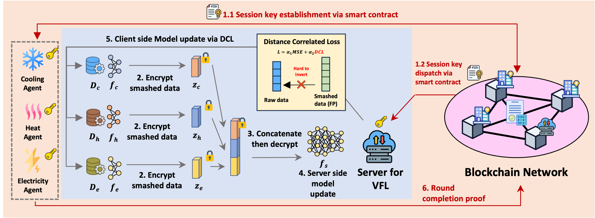

# BC-sVFL：区块链辅助的多能源负荷预测纵向联邦学习

## 1. 工作介绍

**Blockchain-Assisted Vertical Federated Learning for Multi-Energy Load Forecasting**

**BC-sVFL**（BlockChain-assisted secure Vertical Federated Learning）面向冷、热、电由不同运营主体持有数据的多能源系统。各客户端以相同的预测起点协同训练，在保留本地输入和标签的同时，利用跨能源需求之间的关联进行负荷预测。



*图 1：BC-sVFL 总体框架。*

框架包含以下环节：

1. **本地编码：**冷、热、电客户端分别处理历史负荷及辅助特征，得到表示 `z_k=f_k(x_k)`。
2. **功能加密：**客户端加密表示；密钥机构针对服务器权重生成功能密钥，服务器计算首层线性贡献 `U_k=W_k z_k`。
3. **协同预测：**服务器汇总线性贡献并生成共享表示，各客户端通过本地解码器预测负荷、计算损失，再通过梯度交换更新模型。
4. **距离相关正则化：**在预测损失之外加入输入与表示的距离相关项，控制预测效果与表示依赖程度之间的权衡。
5. **区块链辅助记录：**框架中的许可链负责公钥登记和训练记录，通道建立与密钥交付在链下进行。

训练目标为：

```text
R = Σ_k [lambda_k × MSE_k + alpha_k × dCor(X_k, Z_k)]
```

其中 `lambda_k` 是预测任务权重，`alpha_k` 是 DCL 系数，`dCor` 是未平方的距离相关。默认使用过去 168 小时的本地负荷与日历、气象特征，预测未来 24 小时负荷。

本仓库提供 ANN 单能源基线、三客户端 VFL、DCL、可替换的 FE 后端及实验工具，采用单进程角色模拟。区块链层属于框架扩展，不在当前训练执行流程中。

## 2. 安装与快速开始

使用 Python 3.11+，在项目根目录执行。依赖版本在 `requirements.txt` 中固定；已验证环境为 Windows、Python 3.13.9、PyTorch 2.9.1+cpu。

```powershell
python -m venv .venv
.\.venv\Scripts\python.exe -m pip install torch==2.9.1 --index-url https://download.pytorch.org/whl/cpu
.\.venv\Scripts\python.exe -m pip install -r requirements-dev.txt
.\.venv\Scripts\python.exe -m pip install -e . --no-deps
.\.venv\Scripts\python.exe -m vfl_ies train --config configs/smoke.json --output runs/smoke
```

Linux/macOS 使用 `.venv/bin/python`。下文的 `python` 均指虚拟环境解释器。项目采用 editable 安装，以保留数据与配置文件的位置。

输出目录需使用新路径；省略 `--output` 时自动创建带时间戳的目录。

## 3. 项目结构

```text
configs/                     实验配置
data/                        小时数据与预处理窗口
vfl_ies/
  config.py                  参数定义与配置检查
  data.py                    数据窗口、划分、缩放与对齐批次
  models.py                  客户端与服务器模型
  metrics.py                 预测指标与距离相关
  training.py                训练、验证、早停与评估
  crypto/                    明文对照、FE 实现和替换接口
  cli.py                     命令行入口
  benchmark.py               加密模块计时
examples/backend_plugin.py   自定义加密后端示例
tests/                       自动化测试
docs/CRYPTO_INTERFACE.md      加密接口说明
docs/assets/                 框架图
```

阅读顺序建议为 `configs/default.json → data.py → models.py → training.py → crypto/base.py`。

## 4. 数据与实验设置

- 客户端为 `electricity`（电）、`steam`（热）和 `cooling`（冷），同一预测起点的样本共同划分、共同打乱。
- 默认输入包含 168 个小时负荷、24 个小时温度、24 个小时相对湿度及 Month/Year/Week，共 219 维；输出为 24 个小时负荷。
- `*_t-0` 表示预测起点前 1 小时，`*_t-167` 表示前 168 小时，历史输入由近到远排列；目标 `*_t0` 从预测起点开始。
- 2016—2018 为训练候选期，2019 为测试期；默认步长 24 小时，按时间留出最后 10% 的训练候选样本作验证，得到训练/验证/测试 **980/109/365** 个窗口。
- 缩放器仅在训练集拟合。负荷历史和各类气象按各自窗口整体缩放，日历逐列缩放，标签独立缩放；预测使用标签缩放器还原。数值单位保持与数据文件一致。
- `weather="target_observed"` 使用预测时段的气象观测；`weather="history"` 使用起点前最近 24 小时的气象观测。后者使用 `configs/historical_weather.json`。
- `validation="random"` 可切换随机验证；`split_seed` 控制数据划分，训练 `seed` 控制模型及批次随机性。时间验证可用 `purge_hours` 设置额外间隔。

从小时数据生成窗口：

```powershell
python -m vfl_ies prepare --config configs/default.json --output runs/prepared
```

训练使用 `data.source="raw"` 可直接重建窗口；`prepared` 读取配置中的训练和测试 CSV，支持 `history≤168`、`horizon≤24`、`stride=24` 和目标时段气象。`data.root` 相对项目目录解析，也支持绝对路径。

`max_train_samples`、`max_val_samples`、`max_test_samples` 用于限制调试规模；正式实验使用 `null`。仅取各划分前若干样本时，缩放器也按实际训练子集重新拟合。

## 5. 训练、比较与调参

```powershell
# VFL：有/无 DCL
python -m vfl_ies train --config configs/default.json --output runs/vfl_dcl
python -m vfl_ies train --config configs/default.json --alpha 0 --output runs/vfl_vanilla

# 单能源基线：有/无 DCL
python -m vfl_ies train --config configs/baseline.json --output runs/single_vanilla
python -m vfl_ies train --config configs/baseline.json --alpha 0.05 --output runs/single_dcl

# 历史气象输入
python -m vfl_ies train --config configs/historical_weather.json --output runs/vfl_historical_weather

# 重复种子与检查点评估
python -m vfl_ies repeat --config configs/default.json --seeds 42 43 44 45 46 --output runs/repeated
python -m vfl_ies evaluate --checkpoint runs/vfl_dcl/best.pt --output runs/evaluation
```

默认最多训练 300 轮，验证集加权预测 MSE 连续 10 轮未改善时早停。训练完成后加载本次最优检查点进行测试。`repeat` 为各种子保存独立结果与汇总统计；`evaluate` 复用检查点中的配置、特征顺序和缩放参数。

配置支持用 `extends` 继承并覆盖参数：

- `data.*`：窗口长度、步长、数据路径、验证划分、气象输入。
- `model.*`：编码器、表示维度、服务器及解码器尺寸。
- `training.*`：学习率、批大小、轮数、早停、种子、设备、任务权重与 DCL 系数。
- `crypto.backend / options`：加密方法、定点精度和取值范围。

命令行支持 `--epochs`、`--seed`、`--alpha` 和 `--device`；`--alpha` 同时设置三个客户端。单能源基线没有服务器加密层。比较实验时应保持数据划分、气象条件和训练预算一致。

## 6. 加密后端

`plaintext` 是默认的无加密对照；`reference_fe` 提供内积功能加密，保护服务器首个线性层。反向过程使用显式梯度交换。

```powershell
python -m vfl_ies train --config configs/fe_smoke.json --output runs/fe_toy
python -m vfl_ies train --config configs/fe_2048.json --output runs/fe_2048
python -m vfl_ies benchmark-crypto --config configs/fe_2048.json --samples 2 --repetitions 3 --output runs/crypto_benchmark
```

`fe_smoke.json` 使用仅供测试的小整数群；`fe_2048.json` 使用 2048 位群进行小规模实验。加密使用独立随机数，训练种子不固定密文。

替换方法时，实现 `setup / encrypt / keygen / evaluate` 四个接口，将 `crypto.backend` 设为 `your_module:YourBackend`。`examples.backend_plugin:Backend` 提供可运行的适配示例。接口形状、编码和调用约定见 [加密接口说明](docs/CRYPTO_INTERFACE.md)。

## 7. 指标与输出

MSE 对样本和预测小时取均值；DCL 使用有偏估计的未平方 dCor，数值稳定阈值由 `dcor_epsilon` 控制。验证与早停使用加权预测 MSE。

测试 RMSE/MAE 使用还原后的负荷数值；MAPE 为比例，分母取 `max(abs(y), mape_epsilon)`，同时记录近零分母数量。测试 dCor 在前 `eval_dcor_max_samples` 个时间排序样本上整体计算，默认覆盖全部 365 个测试窗口。

每次运行保存：

- `resolved_config.json`、`environment.json`：最终生效配置、环境版本和样本数。
- `split_manifest.csv`、`preprocessing.json`：样本划分和缩放参数。
- `history.csv`、`best.pt`：逐轮损失及验证最优检查点。
- `metrics.json`、`predictions_*.csv`：测试指标和逐小时预测。
- `crypto_timing.json`：初始化、训练、验证、测试的模块耗时与调用次数。

`training_and_validation_seconds` 覆盖训练、验证与循环内检查点写入；独立加密计时记录输入形状和重复次数。实验时间均按本地进程测量。

固定环境、CPU 与训练种子可用于确定性比较；跨设备或依赖版本的结果可能存在数值差异。检查点保存模型及预处理信息，重新评估时创建新的加密上下文。

## 8. 开发检查

```powershell
python -m ruff check vfl_ies tests examples
python -m ruff format --check vfl_ies tests examples
python -m pytest -q
```

代码采用 UTF-8、4 空格缩进和 100 列格式。测试覆盖样本对齐、训练集缩放、梯度一致性、距离相关、FE 内积恢复、后端替换、检查点评估和重复运行。
